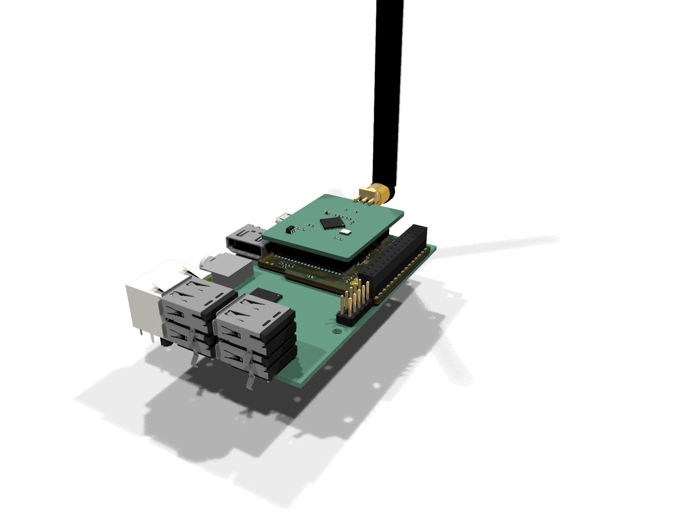
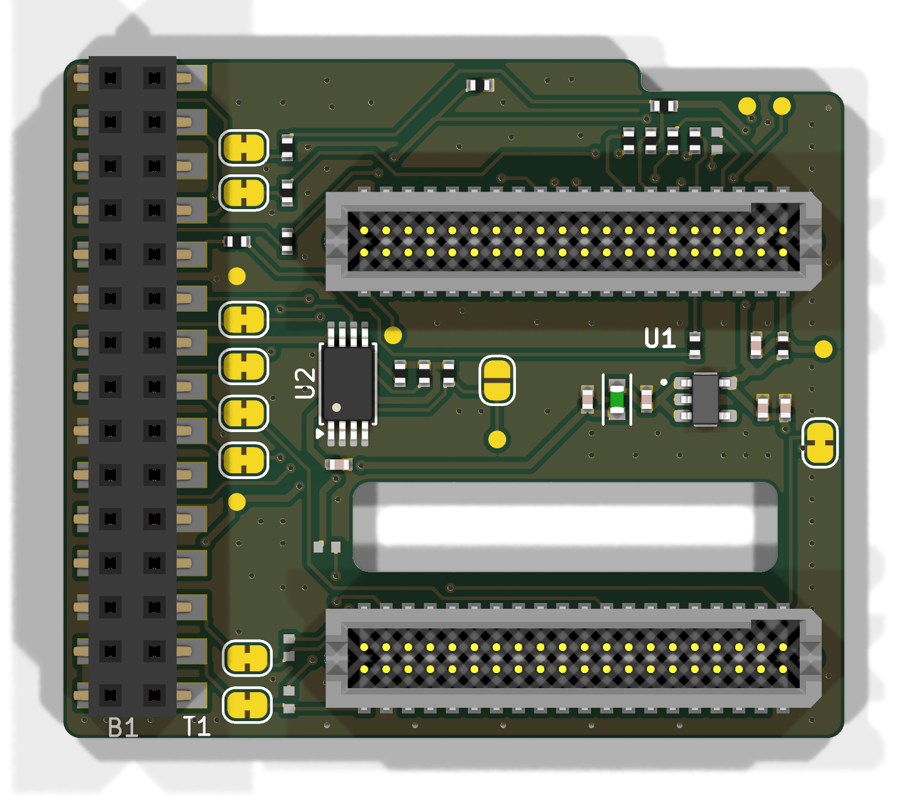
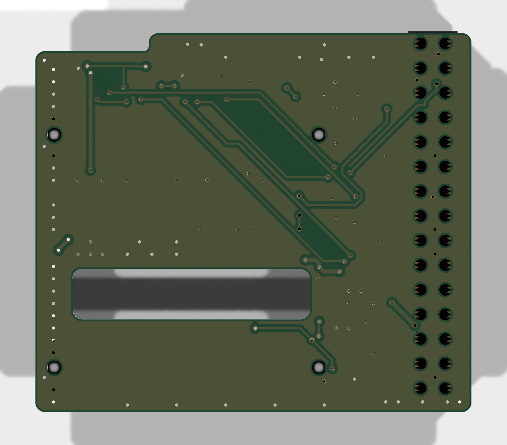
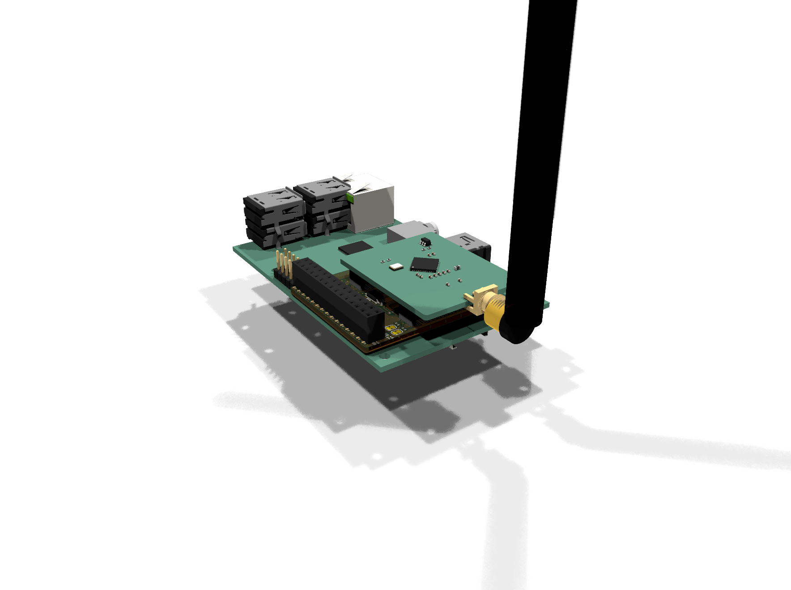
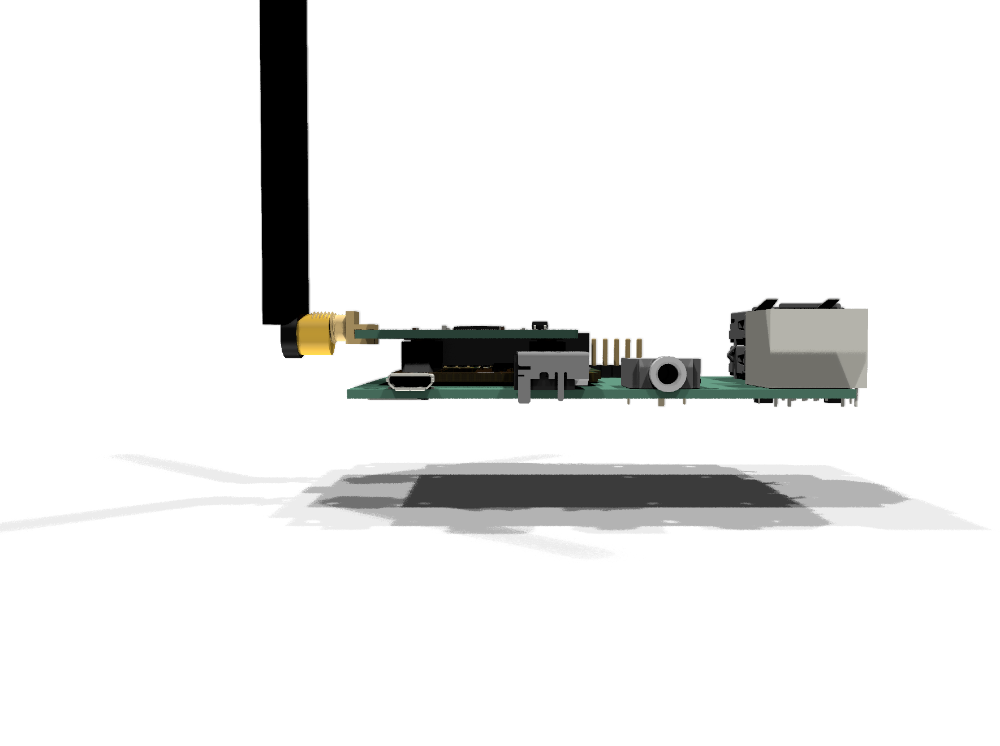

# ionos-maximus RPi adapter, rev A (KiCad 10)

A carrier between a Raspberry Pi and a Silicon Labs radio board (BRD4265B, EFR32FG23). There is no ESP32: the Pi reads the I/Q stream directly over SPI0 (link modes A/B, see the top-level README).

**Status:** schematic done (ERC 0, house-style schematic). Board routed: 2 layers, GND pour on both sides, DRC 0 errors, 0 unconnected, schematic parity 0. Not fabricated or measured yet.

Schematic: [ionos_maximus_schematic.pdf](ionos_maximus_schematic.pdf).

<p align="center"></p>

| Top | Bottom |
| --- | --- |
|  |  |

| Back view | Side view |
| --- | --- |
|  |  |

The stack renders are for orientation only. The Raspberry Pi 3 and the radio board are built from KiCad library parts (40-pin header, USB, RJ45, HDMI, jack, SoC, QFN, SMA) at their drawing positions. They are not vendor models. The radio-board outline and the position of the SMA connector are assumptions, see "Mechanics". Context renders: `gen/render_context.py`.

## Mechanics

The board frame, outline and Pi connector are copied 1:1 from [RPi_ISM](https://github.com/rfsparkling/RPi_ISM) rev1, so the board sits on the Pi exactly like RPi_ISM:

- **Size:** 45 x 39.1 mm, with the same outline, notch and slot.
- **Pi connector:** J1 is a Samtec CLH-115-F-D-DV on RPi header pins 1-30. It uses RPi_ISM socket numbering: J1 pin n = RPi pin n+1 (n odd) or n-1 (n even).
- **Pin coverage:** every pin the README pin map needs lies within pins 1-30, including ID_SD / ID_SC (27 / 28).
- **3.3 V from the Pi:** only RPi pin 17 is used for 3V3_PI (it feeds the ID EEPROM). RPi pin 1 is left unconnected. This avoids a 3V3 trunk across the whole connector.

The radio board sits on P200 / P201: 2x20, 1.27 mm pitch, 24 mm apart. The footprint and the JLC part are the same as on ionos-sdr-mini. The pair is rotated 180 deg compared with ionos-sdr-mini. In this orientation:

- the radio board, with its SMA connector, hangs off the Pi beyond the SD-card edge, away from the USB / Ethernet end;
- the P201 outer row (all I/Q and SWD pins) faces the free top strip.

The slot between P200 and P201 is kept free of copper by a rule area on both layers.

**To verify on a real BRD4265B:**

- The radio-board outline on Dwgs.User is assumed: 32.5 mm along the connectors, with 11 mm / 5 mm overhang beyond P200 / P201.
- Parts up to 1.1 mm high (0402, SOT-23-5, TSSOP-8) sit under the radio board.

## Circuit

| Block | Parts | Notes |
| --- | --- | --- |
| Radio supply | FB1, U1 LP5907-3.3, C1-C5, R1 0R, JP1 | Path: Pi 5 V -> ferrite -> LDO -> VMCU_IN (P201-2). JP1 feeds the board-ID EEPROM (P200-1). R2 (DNP) reaches P200-37, which is USB_VBUS on BRD4265B (5 V is P200-35) |
| I/Q link | R3-R6, R8-R11 22R, R7 10k CS pull-up, R12 10k DRDY pull-down | 22R at both ends of SCLK, CS, DATA and DRDY. JP2 / JP3 = README SJ1 / SJ2 (cut to isolate the Pi). R13 (DNP) = IQ_MOSI |
| cmdlink | R14 0R | Pi PL011 TXD (GPIO14) -> PA06 |
| Board-ID I2C | JP9 / JP10, R18 / R19 (DNP 4.7k) | Cut points as on ionos-sdr-mini (JP3/JP4, R6/R7). Pull-ups not fitted, because the Pi has 1.8k on GPIO2/3 |
| SWD | JP4-JP7 | OpenOCD linuxgpiod from the Pi. Cut JP4-JP7 and use the radio board's own debug connector for an external probe |
| ID EEPROM | U2 CAT24C32YI-GT3 (TSSOP-8), C6, R15/R16 3.9k, R17 1k WP pull-up, JP8, TP3 | Per the RPi HAT design guide; auto-loads the overlays. Bridge JP8 to re-flash |

Changes since the placement-only revision:

- **J2 (Tag-Connect TC2030, DNP) removed.** It blocked the routing channel under the radio board, and SWD is still reachable from the Pi or through the radio board's own debug connector.
- **U2 changed from SOIC-8 to TSSOP-8.** It moved to the band between P200 and P201.

## Files

```
gen/design.py          netlist source of truth (parts, values, footprints, pin -> net)
gen/gen_sch.py         writes kicad/ionos_maximus.kicad_sch + .kicad_sym
gen/mkfp.py            builds kicad/ionos_maximus.pretty from ionos-sdr-mini and RPi_ISM
gen/gen_pcb.py         placement, outline (from RPi_ISM), slot keepout, GND pours (KiCad python)
gen/check_pinmap.py    independent check of the netlist against the README pin map
gen/render_context.py  3D context renders (Pi 3 + radio board + antenna stand-ins)
kicad/                 KiCad 10 project, JLC 2-layer 1 oz rules (.kicad_dru from RPi_ISM)
kicad/3dmodels/        STEP models of every fitted part, referenced via ${KIPRJMOD}
```

To rebuild on Windows with KiCad 10, run `build.ps1`. It regenerates the schematic and runs ERC/DRC.

**Do not use `build.ps1 -pcb` on the routed board.** It runs `gen_pcb.py`, which overwrites the board with a placement-only version and throws away the routing.

## Open

1. Check the BRD4265B outline, the SMA end and the parts under the radio board against a real board.
2. LCSC fields, JLC BOM / CPL.
3. Fiducials, silkscreen title, ID EEPROM image (overlays: spi0-1cs, disable-bt).
